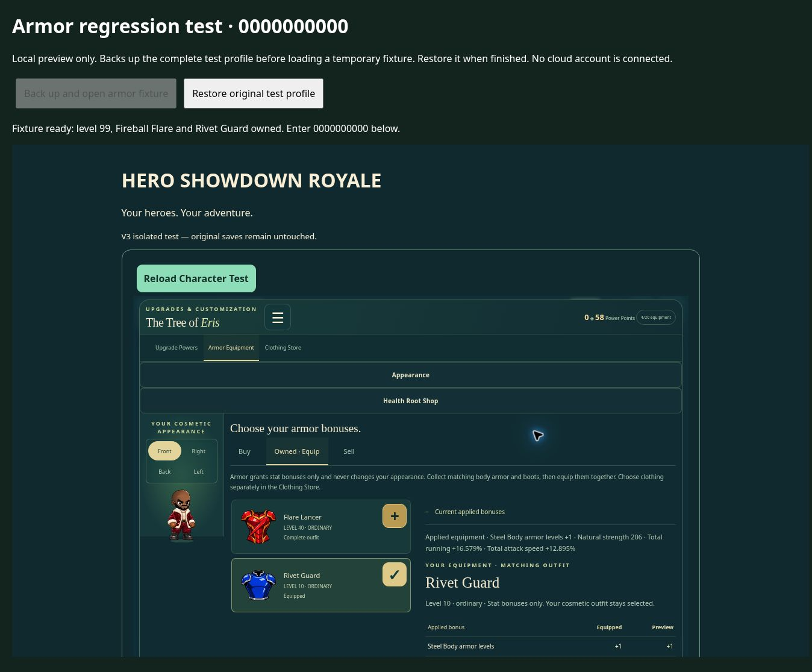

# Armor regression investigation — November 12, 2026

## Finding and scope

The reported combat regression could not be reproduced in current staging. The deployed `equipment.mjs`, `powers.mjs`, `core.mjs`, and `journey.mjs` were fetched and matched main commit `85fadf40f7b1bf488f6050cb36f8ebcfe4a0c034` byte for byte. Actual HP changes for all 118 armor families match `bba835f089f2664fd9605b4a8c44309fcad6178e`, the immediate parent of `d4bec409d27ffe25f1cee63d5f1aa0a1a72c46c1`.

A concrete display defect was reproduced: the equipment table and applied-bonus summary omit effective power-level bonuses. Rivet Guard shows an all-zero comparison and “No stat bonuses” despite applying +1 Steel Body level. This omission also exists in the older menu source; it is not evidence that d4bec40 removed combat bonuses.

The fix adds the existing effective armor levels to the table and summary, using the same matching-set functions as combat. It respects learned-power and hero-level requirements. It changes no combat formula, catalog value, inventory schema, power ledger, cloud endpoint, artwork, outfit, portal, or multiplayer rule. Staging import-map targets are versioned to load the corrected menu.

## Actual combat measurements

Hero level 99, learned powers level 5, stationary level-90 Guardian, normal enemy defense applied. Tests call the normal input/attack clock, melee hit detection, Fireball projectiles, control-effect ticks, `damageEnemy`, and `hurt`; the measurements below are HP subtractions, not menu values. The target is held still and given enough HP to avoid dying during the measurement.

| Measurement | No armor | Equipped armor | Result |
| --- | ---: | ---: | --- |
| Punch HP damage — Shore Guardian | 7.54666667 | 9.54666667 | Increased |
| Kick HP damage — Shore Guardian | 10.83333333 | 12.83333333 | Increased |
| Incoming 100-point hit — Shore Guardian | 100 | 97.5 | Reduced |
| Fireball HP damage — Flare Lancer | 113.68421053 | 160.98245614 | Increased |
| Incoming 100-point hit with Steel Body — Rivet Guard | 70 | 67 | Reduced |

All these values are identical before d4bec40 and after this correction. No maximum-health armor bonus exists in the referenced catalog/stat keys: maximum HP remains 1570 for a level-99 hero. No new health modifier was invented.

## Equipment-to-combat trace

1. `inventory.items` preserves owned item UIDs/catalog IDs; `inventory.equipped` selects the matching body-and-boots pair.
2. `journey.equipItem` validates ownership, matching pieces, level and safe state, then calls `refreshEquipment`.
3. `equipmentBonuses` supplies the authored set totals; the eight matching-power functions supply temporary effective levels.
4. `refreshEquipment` rebuilds `game.equipment` from base plus equipped bonuses. It does not increment learned levels.
5. `Game.attackDefinition` uses physical strength/damage. `PowerSystem.activate` uses effective armor levels. Melee/projectiles/control ticks call `damageEnemy`, which applies target defense and subtracts actual HP.
6. `Game.hurt` calls `PowerSystem.incoming`, which applies equipped defense and active Steel Body before subtracting hero HP.
7. Saves retain inventory and learned levels, and reload recomputes equipment. Appearance goes through the separate armor-free renderer.

## Verification

17 focused tests passed:

- Four new combat tests: 118-family historical comparison; actual equip/remove effects; maxed test powers with repeated refresh/reload; all 36 saved cosmetic selections and armor replacement.
- Two new UI tests first failed on the original omission, then passed after the fix. All eight power-armor families are checked against runtime equipment bonuses.
- Five existing equipment/save tests, including cloud-payload validation and independent local co-op heroes.
- Two existing render tests covering 260 animation/view/costume combinations with zero armor pixel differences.
- Four staging import-map tests. Generated adapters rebuild without additional changes; protected gameplay/art directories have no diff.

Browser checks used the real `0000000000` entry route with an isolated local preview fixture. Verified equip, replacement, removal, costume change (Santa Street to Blossom Kimono), normal Save Game, and Reload Character Test. Rivet Guard retained learned level 5, effective level 6, 33% active protection and 4.2 seconds after reload. Unequipping restored 30% and 4 seconds. The fixture profile and cosmetic preference were backed up and restored exactly.

The reserved `0000000000` mode saves locally by design. It cannot demonstrate a live cloud save/reload. Cloud serialization/validation tests passed; no live cloud account or existing cloud save was changed. The user's device-local affected equipment was not accessible from this separate browser session. A different reported damage failure still needs the exact armor/hero state to reproduce.

## Reproduce

```sh
node --import ./royale-v3-staging/kingjames/tests/register-staging.mjs --test \
  royale-v3-staging/kingjames/tests/armor-bonus-ui.test.mjs \
  royale-v3-staging/kingjames/tests/armor-combat.test.mjs \
  royale-v3-staging/kingjames/tests/armor.test.mjs \
  royale-v3-staging/kingjames/tests/armor-render.test.mjs
node --test royale-v3-staging/kingjames/tests/import-maps.test.mjs
```

The historical comparison loader reads runtime modules directly from the exact baseline Git commit, rather than comparing two copies of current code. The render checks use the repository's existing `@napi-rs/canvas` test dependency.


