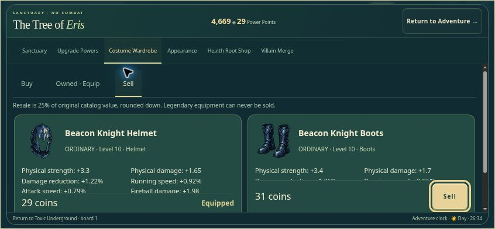
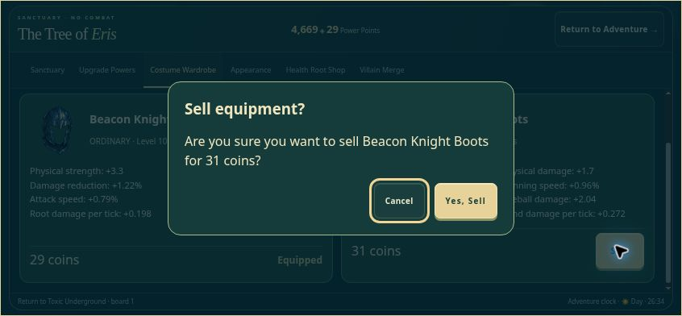

# Equipment selling and offensive balance release

Baseline development: `88ff10dfe09fe70ac9031e2343c171db89ebb97c`. Baseline live: `55f37e5f534f20e2478e7b122525490b8714ec74`. Remote rollback: `rollback/pages-before-balance-20261105`.

## What changed

- Sell is on each owned equipment card, with actual item bonuses, category, rarity, required level and 25% resale price. The card footer stays visible while scrolling its stats. The separate sale detail pane is removed.
- A native modal names the item and amount. Cancel is initially focused. Confirm uses the existing durable transaction and revision checks. Worn and Legendary pieces cannot be sold; worn protection is enforced by `salePreview` and `sellItem`.
- Modal keyboard events stay inside the dialog: Escape cancels without returning to adventure; Tab cannot enter the underlying Tree. Gamepad A confirms, B/Start cancel, directional navigation retains visible focus, and holding A cannot repeat a sale.
- Basic damage growth is reduced. Only the five offensive damage formulas change; innate power damage grows with invested points and hero level. Item stat additions remain exactly additive outside mastery multipliers.
- All original cooldowns, hit timings, hitboxes, target/projectile/kick milestones, resistance, piercing, crowd control, nonoffensive powers, equipment definitions and save schemas are preserved. No XP, monster health, respawn or population changes. Public multiplayer stays disabled.

## Repeatable measurements

Run `node royale/tests/combat-balance-report.mjs /absolute/path/to/baseline/royale` and `node royale/tests/combat-balance-report.mjs`. The same script generated [before](qa/balance/before.json) and [after](qa/balance/after.json): 234 comparisons per build, hero levels 1/10/20/30/50/99, with/without a level-appropriate ordinary complete outfit. Power upgrades 1/5/10/15/20 are included only when obtainable from the earned Power Points; hero level 1 has no Power Points. Remaining points can fund Speed without exceeding the ledger. Seeded randomness and fixed daytime make comparisons reproducible.

Damage and TTK use the production 60 Hz simulation with stationary non-attacking calibration targets. Collision, casting gates, cooldowns, duration and boss Super Strength resistance remain real. These are **not human playthrough times or live boss-AI victory times**. Single-target totals exclude extra victims and piercing to another target. `withBasicFiller60s` activates a power when ready and uses basic punches between casts.

### Basic damage per hit, no equipment

| Hero level | Punch before → after | Kick before → after |
|---|---:|---:|
| 1 | 13 → 5 | 19 → 8 |
| 10 | 40 → 6.62 | 46 → 10.25 |
| 20 | 70 → 8.42 | 76 → 12.75 |
| 30 | 100 → 10.22 | 106 → 15.25 |
| 50 | 160 → 13.82 | 166 → 20.25 |
| 99 | 307 → 22.64 | 313 → 32.5 |

### Power activation damage at hero level 99, no equipment

A full activation includes all kicks/projectiles or damage ticks. Roots and Whirlwind also retain their original control effects.

| Power | Upgrade 1 before → after | Upgrade 20 before → after |
|---|---:|---:|
| strength | 457 → 457 | 609 → 3,654 |
| superKick | 238 → 238 | 942 → 4,239 |
| fireball | 24 → 220 | 357 → 2,835 |
| roots | 12 → 100.2 | 264 → 7,400.4 |
| whirlwind | 20 → 137.6 | 402 → 9,057.6 |

### Sustained damage with full Horizon Champion equipment at level 99

The maximum Speed passive is included where the point budget permits. Power cooldowns are not bypassed.

| Attack / level-20 power | Before DPS, with filler | After DPS, with filler | After power-only DPS |
|---|---:|---:|---:|
| punch | 1,923.85 | 374.09 | 374.09 |
| kick | 1,346.25 | 294.38 | 294.38 |
| strength | 1,979.2 | 868.61 | 502.53 |
| superKick | 1,674.42 | 896.01 | 602 |
| fireball | 2,015.05 | 960.89 | 586.8 |
| roots | 1,943.85 | 869.85 | 495.76 |
| whirlwind | 1,224.32 | 839.27 | 607.04 |

Maxed rotations now deliver 2.24–2.57× basic punch DPS even with the complete outfit. Without equipment, maxed power-only DPS is 3.95–4.89× basic punch DPS. Low-level control powers still have low sustained direct DPS; their advantage includes immobilization/lift, safe range, and basic attacks between casts. These identities and cooldowns remain meaningful.

### Stationary time to defeat, no equipment (seconds)

| Hero | Attack / upgrade | Regular monster HP | Before → after | Regional boss HP | Before → after |
|---|---|---:|---:|---:|---:|
| 30 | punch  | 420 | 0.8 → 7.58 | 6000 | 10.88 → 107.68 |
| 30 | kick  | 420 | 0.88 → 7.28 | 6000 | 15.02 → 104.88 |
| 30 | strength 20 | 420 | 8.05 → 0.05 | 6000 | 144.05 → 32.05 |
| 30 | superKick 20 | 420 | 1.42 → 0.42 | 6000 | 88.93 → 25.8 |
| 30 | fireball 20 | 420 | 5.02 → 0.13 | 6000 | 80.25 → 25.13 |
| 30 | roots 20 | 420 | 20 → 1 | 6000 | 357 → 34 |
| 30 | whirlwind 20 | 420 | 19 → 1 | 6000 | 258 → 23 |
| 99 | punch  | 7000 | 4.1 → 56.72 | 42000 | 25 → 340.15 |
| 99 | kick  | 7000 | 5.95 → 57.42 | 42000 | 35.82 → 344.62 |
| 99 | strength 20 | 7000 | 88.05 → 8.05 | 42000 | 544.05 → 88.05 |
| 99 | superKick 20 | 7000 | 53.92 → 8.48 | 42000 | 336 → 69.95 |
| 99 | fireball 20 | 7000 | 95.13 → 10.13 | 42000 | 585.13 → 70.25 |
| 99 | roots 20 | 7000 | 420 → 6 | 42000 | >1,200 → 85 |
| 99 | whirlwind 20 | 7000 | 309 → 5 | 42000 | >1,200 → 76 |

## Progression pacing

The prior basic formula added +3 damage every hero level: at level 30 punch dealt 100 while a level-1 Fireball stayed at 24. This made basic repetition disproportionately strong. Basic growth is now +0.18 punch / +0.25 kick per level; powers scale with hero progression and invested upgrades.

Enemy health and XP are unchanged. Existing ordinary respawn timers remain 18/36/150 seconds with safe-distance checks. Elevated platforms retain 4/8 populations. Existing XP penalties for outleveling enemies and the level-99 cap remain intact. All seven regions remain accessible as before.

The patrol bot uses an actual second-tier four-monster platform in each appropriate region, real AI, health, respawns and earned XP. It moves and attacks through normal input for up to ten minutes or defeat. It does not dodge/jump and does not spend newly earned points during a run. Power loadouts are legally funded at the starting level. Short runs ending in defeat are not sustained farming estimates.

| Start level | Mode | Before: seconds / kills / end level | After: seconds / kills / end level | Before → after XP/min |
|---|---|---|---|---:|
| 1 | basic punch only | 600 / 125 / 8 | 600 / 115 / 7 | 133.2 → 127.4 |
| 1 | legal powers plus basic filler | 600 / 125 / 8 | 600 / 115 / 7 | 133.2 → 127.4 |
| 10 | basic punch only | 600 / 120 / 10 | 247.45 / 46 / 10 | 48 → 44.62 |
| 10 | legal powers plus basic filler | 600 / 122 / 10 | 315.62 / 61 / 10 | 53.2 → 50.57 |
| 20 | basic punch only | 600 / 120 / 23 | 447.65 / 17 / 20 | 746 → 70.64 |
| 20 | legal powers plus basic filler | 600 / 137 / 23 | 600 / 30 / 20 | 773.1 → 93 |
| 30 | basic punch only | 7.15 / 4 / 30 | 9.75 / 0 / 30 | Not sustained (<60s) |
| 30 | legal powers plus basic filler | 7.15 / 5 / 30 | 11.57 / 7 / 30 | Not sustained (<60s) |
| 50 | basic punch only | 408.05 / 18 / 50 | 79.98 / 2 / 50 | 108.52 → 61.51 |
| 50 | legal powers plus basic filler | 600 / 33 / 50 | 600 / 33 / 50 | 191.7 → 177.6 |
| 99 | basic punch only | 53.92 / 2 / 99 | 13.8 / 0 / 99 | Not sustained (<60s) |
| 99 | legal powers plus basic filler | 600 / 26 / 99 | 600 / 30 / 99 | 0 → 0 |

The ten-minute starting-level-1 basic patrol reached level 8 before and 7 after. Starting at level 20, basic farming reached level 23 before; after the change the bot remained level 20 and was defeated after 447.65 seconds. A powered level-20 patrol survived ten minutes, earning 93 XP/min. At level 99 XP earned is zero. These measurements support removing the basic-attack shortcut, but do **not** establish the full human journey to level 99 or reproduce the reported level-30-in-30-minutes route. XP rewards/requirements were therefore left unchanged.

## Verification

- Baseline Royale: 1,216 passed, 0 failed, 0 skipped.
- Updated Royale: 1,227 passed, 0 failed, 0 skipped.
- Preserved multiplayer: 57 passed, 0 failed, 0 skipped; no public multiplayer server is started.
- Legacy root Story/Versus tests: 37 passed, 16 failed, 0 skipped on both clean baseline and candidate. Failures reference pre-existing missing nested `tests/dist` / `tests/assets` paths. Their files are untouched.
- Preservation checks compare all original artwork, item bonuses, progression/XP/rewards, spawn data, saves, and boss mechanics against the baseline. Only the explicitly allowed damage formulas and worn-sale restriction are normalized in those checks.
- Old tests expecting sale of a worn item now verify rejection then unequip before sale. Damage expectations use the new design values; large target fixtures survive the entire six-tick effect. Boss-test input bots use their owned offensive powers on late encounters instead of relying only on basic attacks; all original phase, death, reward and timing assertions remain.
- Browser tests: 14 checks passed through the production UI with a synthetic standard Gamepad API at 568×320, including B/Start cancellation, Escape, held-A single sale, retained focus, 4,640 → 4,669 coins, and item/equipment restoration after a real document reload. The initial landscape run at 844×390 passed all 12 original checks.
- Manual pointer and keyboard checks passed at 844×390 and 390×844: Enter opens confirmation, Tab focuses Yes, Escape cancels and stays in the Tree; the portrait dialog opens/cancels. The sticky Sell action remains reachable in landscape.
- Physical iPhone, touch hardware and physical-controller hardware are unavailable. Mobile viewport and synthetic Gamepad API results are not real-device verification. A pre-existing development combat-practice page reset discarded the renderer particle pool and crashed on its first hit. Its reset now calls the existing clearParticles method; the production renderer is untouched. After repair, browser clicks activated Fireball, Super Strength, Super Kick, Ground Roots (five rooted targets), and Whirlwind (five lifted targets). The browser extension also emitted unrelated metadata warnings.
- Live deployment verification is reported with the published commit in the delivery message.

## Rollback and future multiplayer

Rollback is a new forward commit restoring the eight published Royale runtime files from the rollback reference. Do not force-push. The Pages workflow publishes main. Development tests/reports stay on the development branch. Keep `MULTIPLAYER_ENABLED=false`; future activation requires the existing authenticated WSS backend and reviewed migration configuration. No Hostinger or DNS changes are part of this release.

## Browser screenshots

