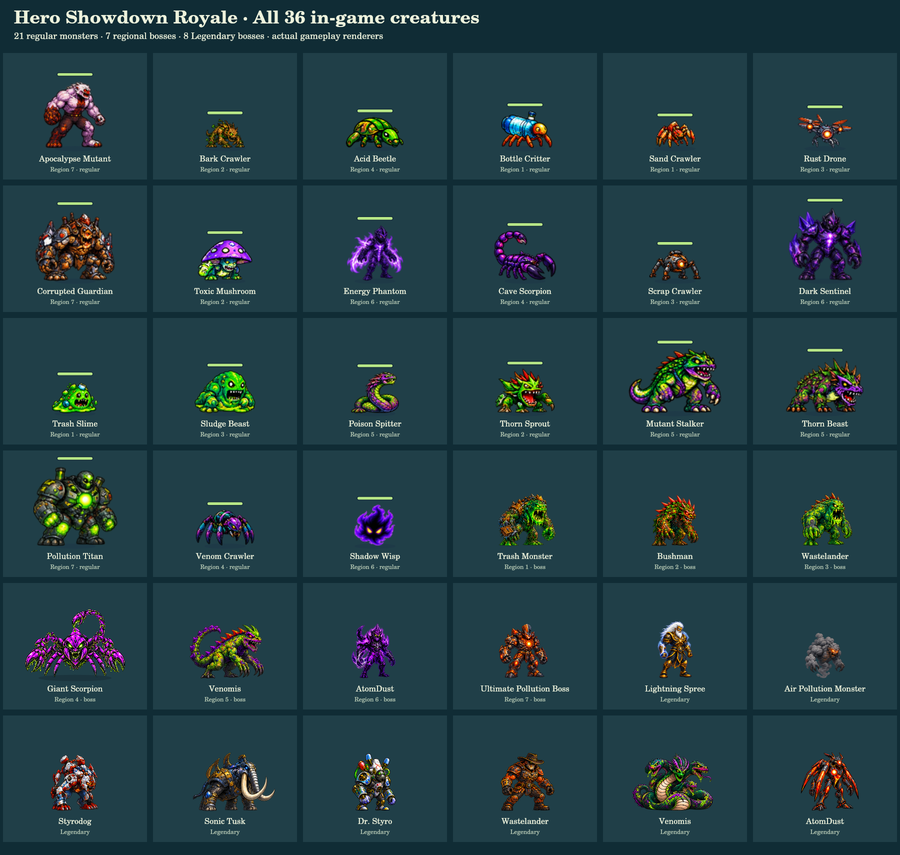
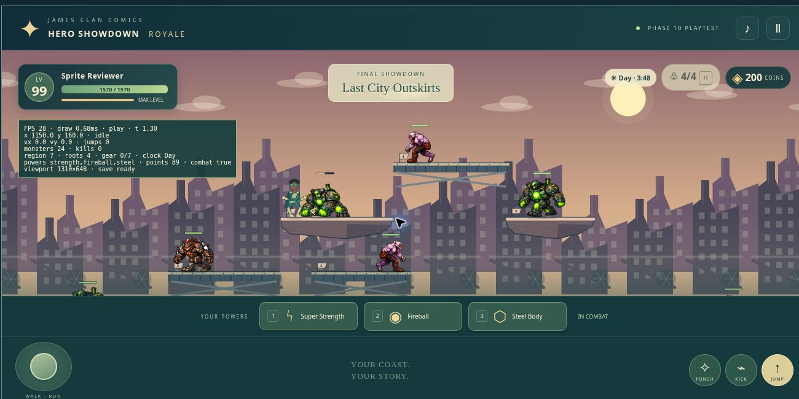
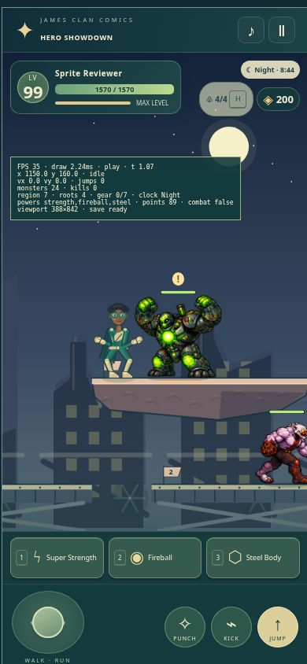
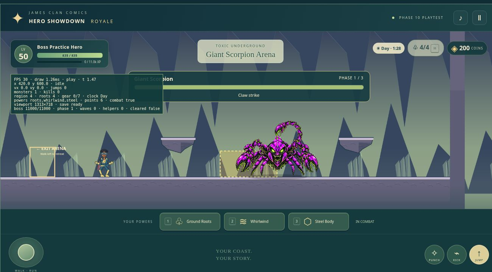

# Combined creature integration review

All 21 regular monsters, seven regional bosses and eight Legendary bosses are combined on `feature/royale-creature-integration`. No runtime code or approved artwork was changed beyond the exact merge of these two sources:

- Monsters: `b8b39dbedd92b89a298e13062abbc545453ff163`
- Bosses: `a5ada842f517e5ab64ad3214eacfb5a6c48806b3`
- Shared ancestor: `838d0ccaa41eb7c2ca616619f8c8c0f806ca1cdf`
- Protected main at start: `b11a1d8103f10e38d63788496660b99d4a8d9e6e`

The source branches changed disjoint files. The merge had no conflicts and required no adapter rewrite. Original boss names and distinct regional/Legendary identities remain intact. Main, Story and Versus are not integration targets.

## Play and inspect

Serve the repository root and open [the combined 36-creature review](tests/creature-review.html). It includes all 36 actual gameplay renderers, selectable animation states, phases, facings, disposable practice encounters and performance samples. The regular adventure is available at [royale/index.html](index.html). Practice uses isolated session storage, not existing hero slots.

The separate hosted review is at https://healthia-royale-creatures-review.gladcreek512.chatgpt.site . The GitHub repository retains all approved source artwork and individual animation frames; the hosted runtime omits unused authoring masters.



## Six preservation assertions corrected

No tests were deleted, disabled or skipped. The six existing tests now call `assertApprovedIntegration()`:

| Test | Old comparison that rejected the approved merge | Replacement |
| --- | --- | --- |
| boss-sprites | Monsters and renderer against the old shared base | Exact approved monster assets/renderer plus exact approved boss assets/adapters and full two-source tree |
| Batch 2 | Modified files against the pre-Batch-2 boss commit | Exact two-source tree; retain immutable earlier boss artwork check |
| Batch 3 | Modified files against the pre-Batch-3 boss commit | Exact two-source tree; retain immutable earlier boss artwork check, including scorpion adapter |
| Batch 4 | Modified files against the pre-Batch-4 boss commit | Exact two-source tree; retain immutable earlier boss artwork check |
| Batch 5 | Modified files against the pre-Batch-5 boss commit | Exact two-source tree; retain immutable earlier boss artwork check |
| Batch 6 | Modified files against the pre-Batch-6 boss commit | Exact two-source tree; retain immutable earlier boss artwork check |

The helper requires both complete source commits, calculates their exact merge tree, rejects unreviewed shared-adapter conflicts, and rejects changes outside a named set of test/review deliverables. There are no runtime or artwork exceptions. It also rejects new unapproved files, compares every monster asset and renderer to the monster source, compares all boss assets/adapters to the boss source, and protects every tracked file outside Royale. Missing Git history fails rather than skips. Remote branch/main preservation is separately verified before and after publication.

This protects HP, damage, XP, coins, drops, AI, 50%-health desperation, all four platform tiers, portals, boss warnings/attacks, Legendary permanent defeats, Villain Merge, hero animation and save formats. Existing behavioral tests remain in place.

## Verification

- Source baselines: **752 monster tests and 698 boss tests passed**.
- Combined suite: **828 passed, zero failed, zero skipped**.
- Focused monster/boss animation tests: **238 passed** (subset of the combined suite).
- Native combined renderer: **9,288 assertions**, all 36 creatures, both facings, five basic states plus every boss phase attack. Nonempty transparent rendering, clipping and simulation immutability checked.
- Monster native raster: **6,658 assertions**, all **628** approved frames, alignment, night eyes, four elevated tiers and two viewport shapes.
- Browser combined renderer: **9,288 assertions** with all 36 loaded and no missing sprite errors.
- Browser monsters: **13,833 assertions**, seven regions, wounded elevated combat, alignment, purity and bounded caches.
- Browser regional encounters: **725 assertions**, seven bosses across five viewport sizes.
- Browser Legendary encounters: **920 assertions**, eight bosses across five viewport sizes, permanent defeat, reward and Villain Merge behavior.
- Browser durable storage: **10 assertions**, including concurrency and crash recovery.
- Browser save/reward edges: **17 assertions**, including storage failures, reward uniqueness and mixed-suit behavior.
- Total browser assertions: **24,793 passed**.
- Differential regression: **7,200 movement/collision/basic-attack steps** against the earlier fixture; later AI/reward mechanics are covered by their dedicated tests.

All test logs, screenshots and machine-readable reports are in [qa/creature-integration](qa/creature-integration/). Browser tests use synthetic controls and disposable saves. In visible Region 7 tier-3 practice, applying 50% damage preserved the enemy's x=1240, y=160 and damage=220. Desktop gameplay showed the hero and multiple approved monsters on elevated platforms. Giant Scorpion gameplay showed its redesigned articulated body and its attack-warning area.





## Measured performance and limits

| Cloud Chrome sample | Viewport | Duration | Displayed average FPS | Mean step + draw | Scene asset preparation |
| --- | --- | ---: | ---: | ---: | ---: |
| Regular region, 24 enemies and power effects | 1300 × 720 | 12.36 s | 1.29 | 6.19 ms | 55.8 ms |
| Giant Scorpion and power effects | 390 × 844 | 12.26 s | 1.30 | 1.65 ms | 62.0 ms |
| Legendary Lightning Spree and power effects | 390 × 844 | 12.31 s | 6.42 | 1.29 ms | 57.7 ms |

These are short cloud samples with previously visited assets, not cold internet loading or physical-device benchmarks. Only 1.25–2.57 simulation seconds advanced during the samples; frame scheduling was much slower than measured drawing, and its cause was not established. **Sustained 60 FPS is not verified.** Native creature-only draw costs ranged from 0.044 to 127.60 ms across 120 draws per creature; this is a separate software-raster measurement, not browser FPS.

The integration preserves the source art's limitations: compact four-pose boss sequences, variable fine details across some generated poses. Sampled states showed no missing sprites or clipping, but automated checks do not establish perfect anatomy or natural motion. Physical iPhone/Android, Safari/Firefox and long-session performance remain untested.

## Reproduce

```sh
node --test royale/tests/*.test.mjs
node --test royale/tests/monster-sprites*.test.mjs royale/tests/boss-sprites*.test.mjs royale/tests/boss-art.test.mjs
node royale/tests/creature-integration-raster.mjs
node royale/tests/compare-phase1.mjs
```

Open `tests/creature-review.html`, `tests/monster-sprites.html`, `tests/phase5-browser.html` and `tests/phase7-browser.html` via HTTP to rerun browser checks. Native raster tooling requires `@napi-rs/canvas`; gameplay adds no dependency. No merge into main is part of this delivery.
