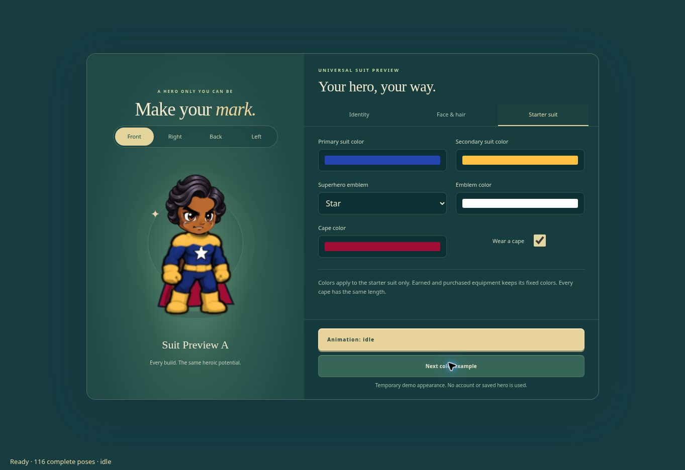

# Universal customizable starter suit

Implements the approved starter superhero design using the existing Action-Chibi
body proportions and complete-frame animation system. The suit replaces the
shared starter body in the production presentation renderer, for every hero name
and both local players. No player account is selected or modified.

## Appearance

- Primary color: bodysuit and trousers.
- Secondary color: shoulder yoke, belt, gloves and boots.
- Emblem: the existing leaf, bolt, shield, star, wave and sun choices.
- Emblem color: independent of both suit colors.
- Cape: optional, with an independent color and frame-authored movement.
- Existing face, skin, eyes and hairstyle rendering is retained.

The source PNGs are complete headless body poses generated from the approved
blue/gold design and the existing atlas poses. They remain unmodified on disk.
Runtime palette masks preserve shading and outlines. Emblems are clipped to
chest fabric; gloves crossing the torso occlude the emblem. Cape contours are
baked into the cached complete frame, without a separate limb or cloth rig.

All 116 frame indices, 17 animation clips, combat timings, head/hand anchors and
foot registration come from the existing shared atlas. `tools/register-starter-suit.py`
rebuilds only the registration JSON from the source PNGs. Steel Body, cosmetic
costumes, armor bonuses, collision, powers and save schemas are unchanged.

## Verification (2026-11-13)

- 185 existing release, gameplay, boss, costume and local co-op tests passed.
- 7 starter rendering tests passed: all-frame recoloring and head contact,
  independent appearance controls, immutable input state, universal dimensions,
  back preview, bounded texture cache, both player directions and Steel Body.
- Browser review used the actual Creator controls and production presentation
  bundle with temporary demo appearances. Local and session storage access were
  disabled. No game account, saved hero or cloud API was used.
- Browser review checked the four color examples, cape on/off, front/back and
  left/right views, running, jumping, double-jumping, punching and kicking.
- No application errors appeared in the browser console during that review.



Run the focused tests with:

```sh
node --test royale-v3-staging/starter-suit/tests/starter-suit.test.mjs
```

To reproduce the isolated browser review after building the normal release:

```sh
node tools/build-royale-release.cjs
node tools/starter-suit-preview.cjs
```

The temporary page is `_site/royale/starter-review.html`. It does not initialize
accounts or saving. A subsequent normal release build removes the review page;
the production module graph never imports the review entrypoint or tests.

Deployment is separate from this review branch. The current production build
redirects the old V3 staging URL to `/royale/`, so publishing `main` changes the
live game. Physical-device and controller playtests were not performed for this
appearance-only change.
