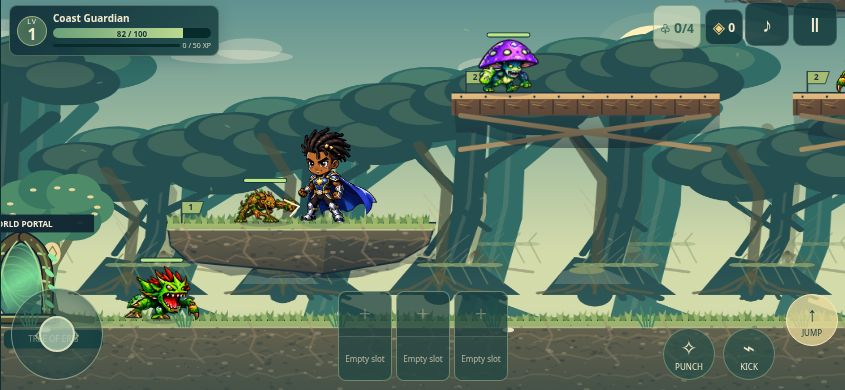

# Final mobile playtest verification

Verified on 2026-11-04. Continued `feature/royale-power-armor-integration` from
`3fdaee3eeba50a703f6a850b1871facd1de7896e`; remote HEAD matched that checkpoint.
Its five existing integration commits were retained. No recovery/rebuild was needed.

## Corrections

- Restored the `cloudStore` / `accountReturn` declaration accidentally swallowed by
  an inline comment. The existing build still uses local browser saves.
- Replaced unavailable cloud-save guidance with the actual manual-save instruction.
- Kept the hero preview visible in short landscape character creation, with
  separately scrolling fields and always-visible Begin/Back actions.
- Increased direct HUD power-selection targets to 44 pixels high.
- Fixed the Jump button extending 13 pixels beyond a 568-pixel screen at the
  largest control setting. The existing compact layout now sizes Jump consistently.
- Corrected obsolete keyboard inputs in three browser test scripts: Left/Right
  for movement and Up for treasure interaction. Assertions were retained.
- Added a reproducible `npm test`, a byte-preserving playtest packager, and
  regressions for final preservation, packaged imports and landscape UI flows.
- Pinned the missing native canvas test dependency; installed the existing locked
  database/test dependencies. Removed no tests and weakened no assertions.

## Automated results

Counts below are separate suites, not a single undifferentiated test total.

| Suite | Passed | Failed | Skipped |
|---|---:|---:|---:|
| Clean Royale baseline, before edits | 1,173 | 0 | 0 |
| Final Royale Node suite | 1,175 | 0 | 0 |
| Production creature raster checks: 21 monsters + 15 bosses | 9,288 | 0 | 0 |
| Responsive input, creator, powers, world: 20 browser runs | 1,620 | 0 | 0 |
| Seven regional bosses across five viewports | 725 | 0 | 0 |
| Eight Legendary bosses across five viewports | 920 | 0 | 0 |
| Legendary durable storage, duplicate reward and failure recovery | 27 | 0 | 0 |
| Phase 10 integration, local persistence and recovery | 100 | 0 | 0 |
| Final landscape creation, menus, maximum controls, save/reload | 130 | 0 | 0 |
| Portrait and landscape synthetic multitouch replays | 34 | 0 | 0 |
| Existing root and Scorpion QA Node suites | 67 | 0 | 0 |
| Nested legacy suites using their expected filesystem layout | 631 | 8 | 0 |

The browser suites total **3,556 passing assertions**. Test fixtures deliberately
accelerate simulation, seed heroes/equipment, enter arenas and stage boss damage.
These are real browser integration tests, not an unassisted playthrough.

Initial test setup failures came from missing dependencies and three temporary
checkout transfer files. After installing locked dependencies and moving those
temporary files outside the checkout, the unmodified Royale baseline passed.

The eight remaining failures are legacy `scorpion-rig.test.cjs` connected-geometry
expectations at x = 110, 220, 380, 640, 790, 940, 1060 and 1170:
`2.852765166211934 != 0`. The nested tests originally resolved nonexistent
`tests/dist` / `tests/assets` paths. They were copied unchanged to a temporary
layout with the expected asset links to distinguish path errors from assertions.
Their shared rig and tests are byte-identical to the checkpoint; modifying
Story/Versus/shared artwork is outside this task. The complete repository is
therefore **not** being represented as all green.

## Coverage and preservation

The Royale suite covers all nine power collections, 81 suits / 243 persistent
pieces, every tier, buying/equipping/removing mixed sets, bonuses, cooldowns,
save compatibility, all nine powers, immediate Power Point upgrades, level 99,
three HUD slots, Villain Merge and its Tree of Eris restrictions. Existing
Style C checks cover both presentations, 49 saved hairstyles, appearance controls,
body-build extremes, connected joints, cape/equipment drawing and animation poses.

Boss checks exercise all 15 approved designs, attacks, collision zones, phases,
damage, helpers, defeat, chest presentation and duplicate-claim protection.
Lightning Spree retains one yellow ground warning area at a time.
Chest rendering never issues rewards; the original claim logic remains in charge.

No approved artwork changed: heroes, atlases, hair, all 36 creatures, all Power
Armor, capes and the approved chest bitmap remain byte-for-byte unchanged.
No combat definitions, timings, damage, cooldowns, physics, rewards, progression,
input mappings, save schemas, main-page files, Story Mode or Versus Mode changed.
The preservation regression compares against the exact checkpoint above.

## Browser playtest record

Landscape checks passed at **568×320, 667×375, 844×390, 932×430 and 1024×768**.
The broader existing suites also cover narrow portrait, tablet portrait and
desktop layouts. Visible controls were measured for viewport bounds and overlap,
including maximum configured button/stick sizes. Safe-area CSS and
`viewport-fit=cover` are present; physical cutout behavior is not hardware-tested.

| Requested step | Evidence |
|---|---|
| Launch; select/create a hero | Launched in Chrome; normal and isolated heroes created through UI |
| Select costume / body / presentation | Creator and wardrobe UI exercised; automated appearance coverage |
| Enter world; walk/run/double-jump | Browser input suites, pointer replays and direct keyboard input |
| Punch and kick enemies | Direct input and live combat replay; collision/damage regressions |
| Equip and activate powers | All nine tested through browser UI; direct HUD selection and immediate upgrades |
| Defeat regular monsters | Covered by combat regressions; full ordinary progression not manually completed |
| Encounter bosses / observe warnings | All 15 arena fixtures and rendered warning-zone checks |
| Defeat boss; open chest; collect | All 15 browser arena flows with staged damage and original reward logic |
| Tree of Eris / equipment changes | Real menu flows plus all 81 suit integration cases |
| Save, reload, confirm persistence | LocalStorage and IndexedDB browser flows, appearance/gear/claim recovery |

Actual landscape replay frame:



## Reproduce and package

```sh
cd royale
npm ci
npm test
npm run build:playtest -- /absolute/path/outside/repository/royale-playtest
```

Serve the resulting folder using any static HTTP server. `START-HERE.txt` contains
desktop and same-Wi-Fi iPhone launch instructions. `build-manifest.json` records
the exact source commit, dirty state, byte sizes and SHA-256 hashes of copied files.
The packager checks every copy and includes all production imports and approved
runtime assets; it does not regenerate, resize or recompress artwork.

For browser reruns, serve the build and open `/royale/tests/mobile.html`,
`final-mobile.html`, `mobile-patrol.html`, `phase5-browser.html`,
`phase7-browser.html` or `phase10-browser.html` under that tests directory.
Disposable equipped trials are available at `/royale/armor-review.html`.

## Remaining limits

- No physical iPhone, iOS Safari, Android device or reserved browser-gesture test.
  Chrome viewport/synthetic-pointer checks do not prove physical-device behavior.
- No unassisted level 1–99 playthrough or manual defeat of every boss.
- No guarantee of zero clipping for every possible customization at every frame;
  broad renderer, attachment and browser checks passed, and approved artwork stayed intact.
- No new sustained-device performance/battery benchmark. Earlier integration
  measurements already recorded uneven cloud-browser frame pacing; this build
  does not claim a smooth 60 FPS result.
- Cloud/cross-device saves remain unavailable in this existing build. Use the same
  browser and site address, and choose **Pause → Save Game** outside combat.
- Eight unrelated legacy Scorpion geometry assertions remain failing as documented above.
