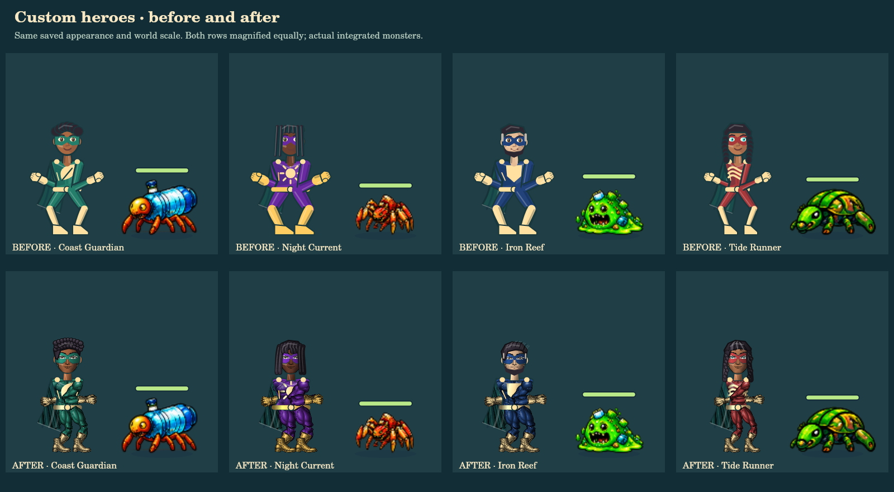
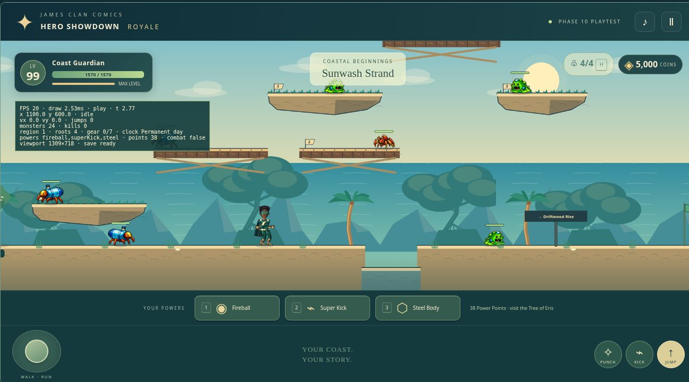
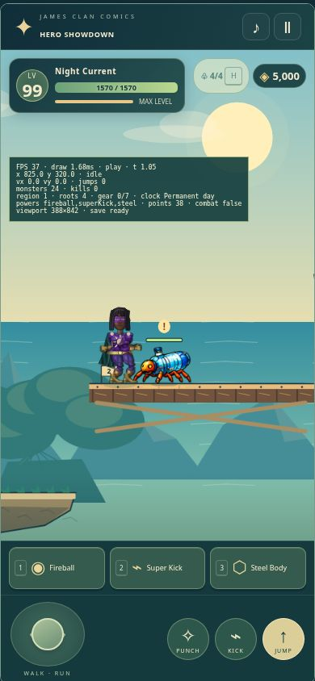

# Custom hero graphics and animation review

The customizable Royale hero now uses painted comic materials, articulated limbs, richer facial features and hair, alternating punches, chambered kicks, movement-driven strides and reactive cloth. The player's saved identity, colors, proportions and equipment still drive the renderer. No fixed Healthia character replaces the custom hero.

Development branch: `feature/royale-hero-animation`, based exactly on verified integration `67c885e14cb8a41bb55772802d3849d498ea3913`. Main, Story, Versus, the integration branch and both creature source branches are protected. No merge into main or further integration is part of this delivery. Visual approval is pending.

## Play and compare

Open [the interactive hero review](tests/hero-review.html). It has editable examples, every saved appearance control, all 23 pose previews, both facings, starter/rare/Legendary equipment, and disposable playable practice in all seven regions and four elevated tiers. The game runs at its existing scale. The before-and-after fixtures are the actual approved renderer, verified against the base commit, with import paths relocated only.

The separate private hosted review is https://healthia-royale-hero-review.gladcreek512.chatgpt.site . Existing creature review hosting is unchanged.

The supplied 512 × 1108 gameplay recording was inspected for proportions and readability. No world-space hero scale, body dimension formula, collision box or camera setting changed. Hero and monster figures in the comparison below are enlarged equally.





[20-second animation close-up](qa/hero-animation/animation-closeup.mp4) · [18-second gameplay capture](qa/hero-animation/gameplay-desktop.mp4) · [Eight custom heroes](qa/hero-animation/customization-gallery.png) · [All action poses](qa/hero-animation/animation-poses.png) · [Equipment examples](qa/hero-animation/equipment-gallery.png)

The videos are deterministic captures of the actual renderer. The gameplay clip runs the unchanged simulation at 60 fixed steps per second and exports 30 video frames per second. It includes regular enemies, powers, elevated platforms and Lightning Spree. The staged QA hero is invulnerable; this is not an unassisted combat or device-performance recording.

## Presentation changes

- Two authored transparent material sheets supply suit anatomy, fabric shading, boots, gloves, head underpainting and selectable facial overlays. Runtime tinting retains saved colors. Hair, face shape, age, eyes, facial hair, build, sliders, emblem and cape remain independent controls.
- Strides follow actual travel distance. Planted feet cancel forward world travel; knees bend forward, run strides and arm swings grow with speed, and weight and torso lean shift cosmetically.
- Punches alternate from the existing attack serial with shoulder/hip motion, anticipation, extension and recovery. The active hand remains at the original contact used by power artwork. Kicks chamber, extend during the original active window, retract and recover; Super Kick retains its distinct combo twist.
- Jump, double-jump, fall, landing, aerial attacks, hurt, defeat and respawn retain responsive simulation transitions. Blinks, subtle breathing/weight shifts, hair movement and a brief cosmetic turn accompany the existing damped cape chain.
- The tint cache is bounded to 48 small material canvases. The original vector renderer remains the loading/error fallback; new rendering does not block input or delay attacks.

Artwork provenance and exact generation prompts: [PROMPT.md](assets/hero/PROMPT.md). Original unedited outputs: [body materials](assets/hero/ink-materials.png) and [facial features](assets/hero/face-features.png). No approved monster or boss artwork was regenerated or edited.

## Preservation and tests

Only `hero-art.mjs`, `hero-rig.mjs` and the new `hero-materials.mjs` change runtime presentation. The appearance schema, save logic, inventory, powers, input, movement, gravity, jump heights, damage, cooldowns, hitboxes, creature AI/stats/drops, regional combat, Legendary mechanics, Villain Merge and all creature assets/adapters remain byte-for-byte identical to the integration commit.

The six existing creature preservation assertions remain active. Their shared helper now invokes an additional exact integration-baseline guard, permitting only the named hero presentation files, authored hero assets and review evidence. Existing exact comparisons against both approved creature source commits are retained. No test was deleted, skipped or disabled.

| Verification | Result |
| --- | --- |
| Untouched integration baseline | 828 passed; 0 failed/skipped |
| Complete final suite | 874 passed; 0 failed/skipped |
| Existing rig, power and elevated-platform focused tests | 207 passed; included in full suite |
| Hero rendering matrix, native and Chrome separately | 6,443 assertions each; 2,139 renders, 23 poses, all appearance controls, 155 equipment items |
| Creature rendering matrix, native and Chrome separately | 9,288 assertions each; all 21 monsters and 15 bosses, phase attacks, facings, hit and defeat |
| Responsive input, creator/save, power and world UI | 1,375 assertions; all 20 suite/viewport combinations passed |
| Regional boss encounters | 725 assertions; seven bosses × five viewports |
| Legendary combat and permanent progression | 920 assertions; eight bosses × five viewports |
| Durable storage / crash recovery and reward/save edges | 10 + 17 assertions |
| Total browser assertions | 18,778 passed |

Viewport sizes: 390 × 844, 844 × 390, 320 × 568, 768 × 1024, 1280 × 800. Input tests exercise keyboard movement/run, double-jump, air steering, simultaneous synthetic touch, attack buttons, focus loss and controller mappings. Creator tests save/reload every appearance option, preserve legacy slots, and verify all pose renders. World checks retain seven-region travel, gear, rewards and saving restrictions.

Sampled hero and creature states were visible, unclipped, finite and did not mutate simulation state. In the phone-sized practice, Night Current fought a Bottle Critter on tier 2, received normal damage, defeated the enemy, earned its coin/equipment and jumped using the actual touch controls. Logs and machine-readable evidence are in [qa/hero-animation](qa/hero-animation/).

## Measurements and limits

| Measurement | Desktop | Phone-sized |
| --- | ---: | ---: |
| Cloud Chrome viewport | 1296 × 540 | 390 × 844 |
| Sample duration | 12.03 s | 12.31 s |
| Observed rAF average FPS | 1.66 | 1.30 |
| 1% low FPS | 0.98 | 0.98 |
| Mean simulation + draw cost | 8.94 ms | 7.64 ms |
| Scene asset preparation, visited assets | 63.3 ms | 55.7 ms |
| Enemies / simultaneous effects | 24 / 5 | 24 / 5 |

Both cloud samples reported visible/focused pages and no sprite errors. Only 1.47 and 1.30 simulation seconds advanced; browser frame delivery was much slower than drawing, and the cause was not established. These are limited cloud measurements, not representative physical-device results or cold internet load times. **Sustained 60 FPS is not verified.**

Separate native software-raster measurements: hero-only mean draw cost 0.30–0.77 ms across eight appearances (180 draws each); full gameplay capture with two simulation steps per draw averaged 5.43 ms, with 9.32 ms p95 across 540 frames. These costs are not browser FPS.

No physical iPhone, Android or controller hardware was tested. Safari/Firefox, long-session performance and cold-network loading remain unverified. Existing rare equipment and Villain Merge overlays retain their approved vector shapes and glows, so some equipment is visually simpler than the new painted base suit. Fine facial detail is intentionally small at the preserved gameplay scale. Modular 2D parts do not provide full 3D perspective rotation; the default facing changes immediately with a subtle squash. Original compact creature animation limitations remain unchanged. Final artistic and motion approval belongs to the user.

## Reproduce

```sh
node --test royale/tests/*.test.mjs
node royale/tests/hero-raster.mjs
node royale/tests/hero-record.mjs
```

Native evidence tools require `@napi-rs/canvas`; recording also requires FFmpeg. Gameplay adds no package dependency. Serve the repository root and open `royale/tests/hero-review.html`, `mobile.html`, `phase5-browser.html` and `phase7-browser.html` for browser validation. Review practice uses isolated session storage and never replaces existing hero saves.
