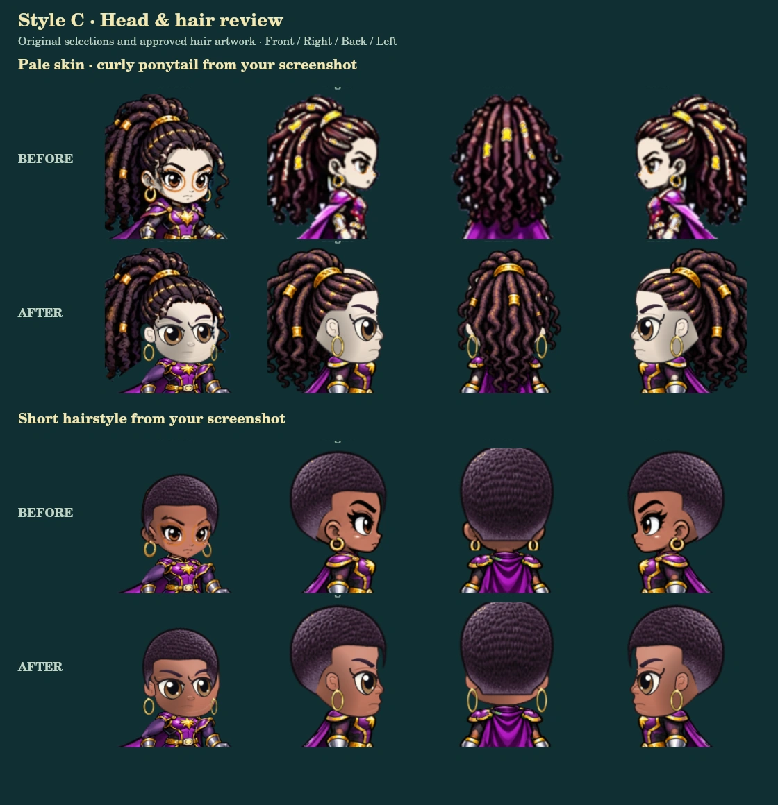

# Style C head and hair review

Status: REJECTED by Chris. Do not publish or merge this redesign. Chris requires the original illustrated faces. Continue on `feature/royale-v3-original-face-fixes` at commit `2a435a65444935e8b3524b008932a4ff8f4dc744`. The official game was never changed by this rejected branch.

Release baseline: `5defeb33c626d19755b26f030b5e7b840f6b4b77`.

## Appearance approval



The “before” captures were rendered from the release baseline before the head implementation was edited. Both sets use identical appearance selections and camera framing. The existing front view remains the game's established three-quarter view. The new face is cleanly shaded and independently drawn; its appearance is submitted for approval, not assumed to be approved.

| Review | Before | After |
| --- | --- | --- |
| Screenshot examples, dark female and light male | [Heads 1](before-heads-1.webp) | [Heads 1](after-heads-1.webp) |
| Beard, stubble, fantasy skin, older bald hero | [Heads 2](before-heads-2.webp) | [Heads 2](after-heads-2.webp) |
| Complete characters and retained costumes | [Characters](before-characters.webp) | [Characters](after-characters.webp) |
| Female hairstyles 1–12 | [Sheet 1](before-hair-female-1.webp) | [Sheet 1](after-hair-female-1.webp) |
| Female hairstyles 13–24 | [Sheet 2](before-hair-female-2.webp) | [Sheet 2](after-hair-female-2.webp) |
| Female hairstyles 25–36 | [Sheet 3](before-hair-female-3.webp) | [Sheet 3](after-hair-female-3.webp) |
| Female hairstyles 37–48 | [Sheet 4](before-hair-female-4.webp) | [Sheet 4](after-hair-female-4.webp) |
| Male hairstyles 1–12 | [Sheet 1](before-hair-male-1.webp) | [Sheet 1](after-hair-male-1.webp) |
| Male hairstyles 13–24 | [Sheet 2](before-hair-male-2.webp) | [Sheet 2](after-hair-male-2.webp) |
| Male hairstyles 25–36 | [Sheet 3](before-hair-male-3.webp) | [Sheet 3](after-hair-male-3.webp) |
| Male hairstyles 37–48 | [Sheet 4](before-hair-male-4.webp) | [Sheet 4](after-hair-male-4.webp) |

The local development page at `royale/tests/head-review.html` exposes the actual game renderer with all four views, existing appearance selections, animation poses, equipment, and the comparison gallery. It does not access player storage or accounts. See [browser review capture](browser-review.jpg).

## Root causes and implementation

The old paths retained baked facial artwork while adding replacement features over it. Incomplete skin material boundaries left the default warm color around the eyes. Profile customization also warped the original face rather than replacing its feature layers. Separately, the explicit `right` view was falling through to the front renderer instead of using the profile artwork.

`style-c-head.mjs` now draws independently composited skin, ears, eyes/eyelids, brows, nose, mouth, facial hair and accessories. Skin shades derive from the selected skin color; iris whites and dark linework remain intentional. Jaw changes reshape the lower contour without moving the scalp or hair registration. The back view draws no face. A bounded head cache avoids rebuilding bitmaps every animation frame.

Hair uses the existing front, side and back illustrations, anchored to the same animated head. Left mirrors the complete profile; right selects the actual profile. Native default locs and ponytail artwork is retained by separating whole hair silhouettes from the old plates, including gold cuffs, rather than repainting individual old facial regions. The established body, cape, costume, equipment and motion artwork remains unchanged. Neutral heroes now use the same existing layered body path as customized heroes, so the new head can move consistently with it.

No appearance IDs, player save schema, auth code, autosave timing, gameplay rules, statistics, progression, loot or other modes were changed. Original assets and the old face renderer remain available as rollback references in this branch and at the release baseline.

## Verification

| Check | Result |
| --- | --- |
| Head/material, feature replacement, jaw, direction, cache and compatibility tests | 12 passed |
| Existing combat, loot, menu and controller regressions | 42 passed |
| Both presentations × all hairstyles/bald × three skin/jaw combinations × four views | 1,176 renders |
| Both presentations × all hairstyles/bald × four views × twelve movement/power poses | 4,704 rendered frames |
| Interactive browser hairstyle/direction render check | 392 combinations passed |
| Existing browser menu/controller/resume checks at 844×390, 568×320 and 390×844 | 258 passed |
| Eight-second save snapshots and reload with the new female and male appearance fixtures | 20 passed |
| Warm full-hero render benchmark on the native Canvas test runtime | 1.267 ms/frame; not a mobile-device FPS claim |

The browser save fixture retained both visible heroes' appearance selections, levels, XP, inventory, powers, Health Roots, health and exact position. Slot 3 remained hidden and its fixture record untouched. Gameplay rendering was also inspected in the running isolated test game. These tests use isolated fixture storage and cloud-save snapshot events; they do not claim a new live Supabase account roundtrip. Existing player saves and backend records were never accessed or rewritten.

Original asset and protected production-file comparisons against the release baseline passed. The eight-second production autosave statement is unchanged. All hair review sheets were visually inspected; the screenshots are provided for the user's final aesthetic decision.

Commands:

```sh
node --expose-gc --test royale/tests/layered-heads.test.mjs
node --test royale/tests/v3-combat.test.mjs royale/tests/v3-loot.test.mjs royale/tests/menu-gamepad.test.mjs royale/tests/menu-navigation.test.mjs
node royale/tests/render-head-review.mjs after
```

The raster review harness uses the repository's `@napi-rs/canvas` test dependency. Local PNG captures are excluded; compact WebP comparisons are committed. The render script protects the existing before baseline against accidental replacement.

Deployment is intentionally pending visual approval. Do not merge this branch into the live Pages source until that approval is recorded.
