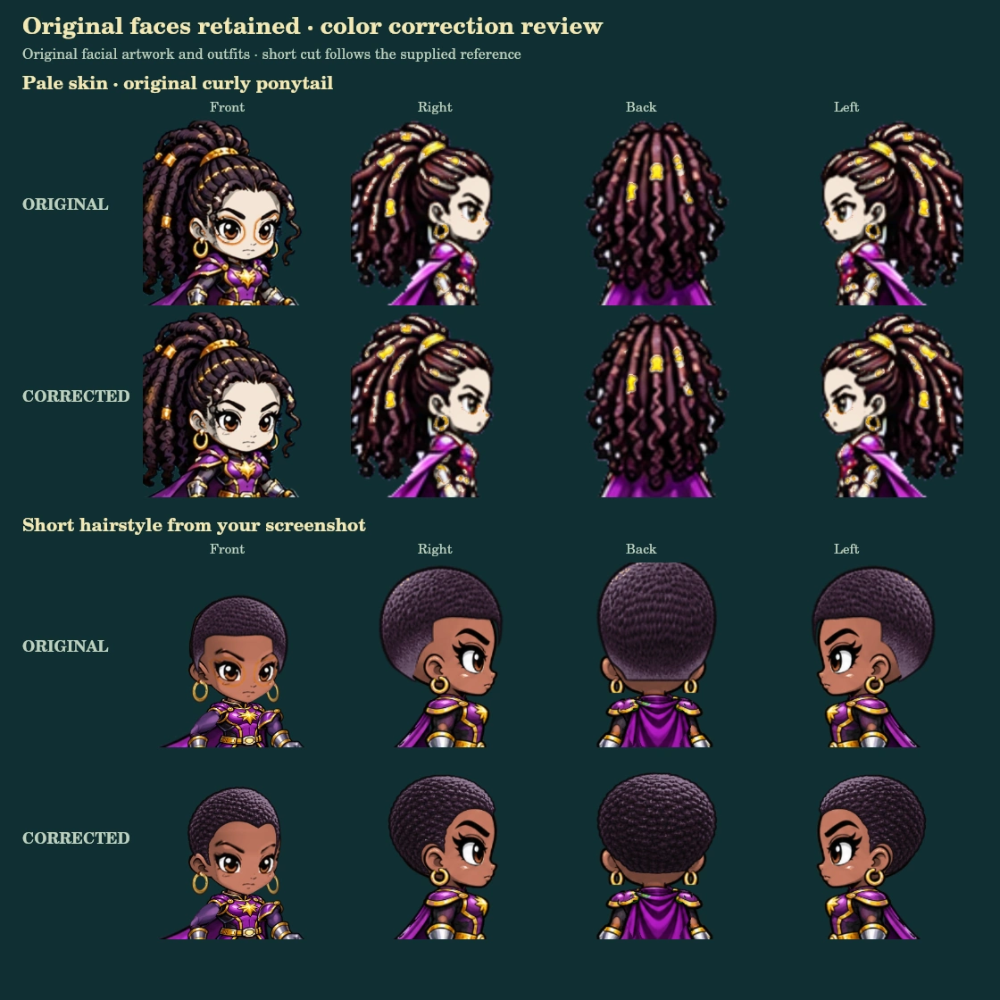

# Original Style C faces — correction review

Awaiting visual approval. The official game has not been changed.

Chris rejected the redrawn faces in `8502b9c8db9d894c22e75fe7990c6e4430f73af4` and required the original appearance. This branch starts again from the verified release `5defeb33c626d19755b26f030b5e7b840f6b4b77`. It contains none of the rejected head renderer, hair reconstruction, or body-rendering changes. Do not deploy the rejected branch.



The original eyes, facial geometry, linework, proportions, hair and costume illustrations are retained. Corrections affect how colors are assigned and how changed features replace their original component. No artwork has been regenerated or edited.

## Corrected defects

- The skin material mask omitted skin beyond the eye-feature rectangles. Recover that material across the original head, preserving iris, eye whites, ink and gold accessories.
- Erased eyebrow pixels were still classified as eyebrow material. Their skin underlay therefore kept the original orange color. Recolor the original feature and the exposed skin separately before compositing.
- Eye and eyebrow masks overlapped. Keep original brow ink separate from eye transformations so changing the eye shape does not duplicate the brow.
- Recover omitted skin material in the original profile's eye region without replacing profile art.
- Route the explicit `right` view to the existing profile renderer. The creator's established `side` route and existing hair fit corrections remain intact.

## Visual review

- [Eyebrow, mouth and eye selections](facial-selections.webp)
- [Screenshot examples, dark female and light male](examples-1.webp)
- [Beard, stubble, fantasy skin and older bald hero](examples-2.webp)
- [Working browser preview](browser-review.jpg)

The local review page is `royale/tests/original-face-review.html`. It uses the same renderer as the game and can switch all existing appearance selections, directions, equipment and animation poses. It does not read or write player accounts or saves.

## Verification

Eight focused tests passed, including an exact comparison of **2,744 rendered frames** against the release renderer: both presentations, all 48 hairstyles plus bald, four established views, and idle/walk/run/jump/fall/punch/kick. With the original palette and facial selections, every compared pixel matches. Color correction also preserves the original alpha silhouette at light, medium, dark and fantasy skin colors. The tests reproduce the old orange eyebrow ghost and confirm its removal.

All 42 existing targeted menu/controller, loot/inventory and combat regression tests passed. The browser rendered 392 hairstyle/direction combinations successfully. Twenty browser save checks passed with the original-art appearance fixtures: both visible slots, eight-second save snapshot cadence, levels, XP, all 20 equipment records, powers, Health Roots, selected appearance, exact position/health, document reload and hidden Slot 3 retention.

Browser save verification uses isolated fixture storage and cloud-save snapshot events. No live player save or backend account record was accessed or rewritten; this is not a claim of a new live authentication/backend roundtrip. Authentication, saves, slot visibility, gameplay, combat tuning, equipment, body/cape assets, and other modes are unchanged from the release baseline.

```sh
node --expose-gc --test royale/tests/original-face-fidelity.test.mjs
node --test royale/tests/menu-gamepad.test.mjs royale/tests/menu-navigation.test.mjs royale/tests/v3-loot.test.mjs royale/tests/v3-combat.test.mjs
node royale/tests/render-original-face-review.mjs
```

The test-only reference loader reads source modules from the release commit and shares unchanged artwork read-only. Both comparison rows are rendered with identical selections and framing. The Canvas test dependency is `@napi-rs/canvas`.

Publish only after approval of this original-art correction. The prior redrawn-head proposal remains rejected.
