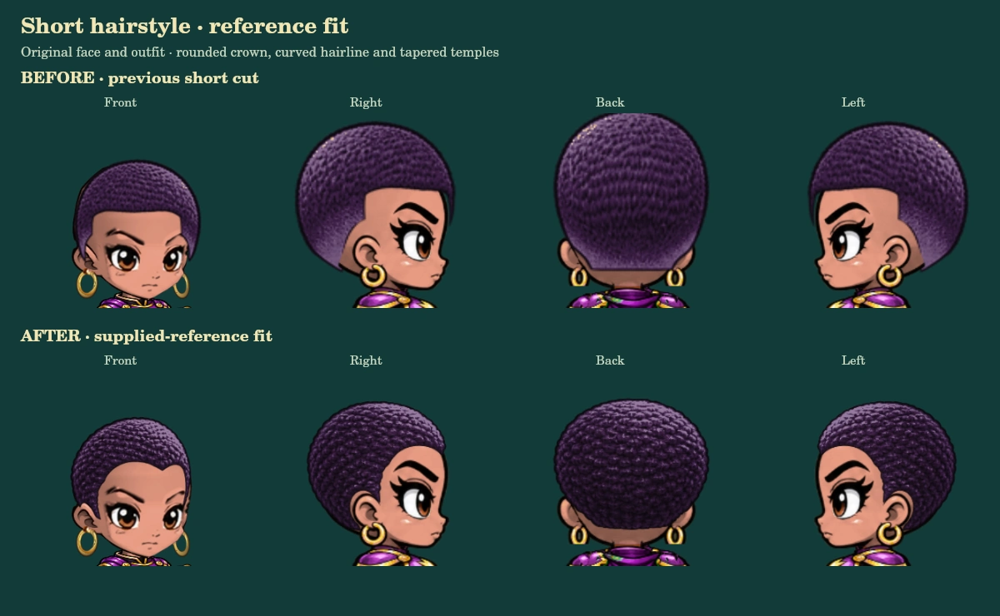

# Original Style C faces and reference short hairstyle

**Development review only. Awaiting visual approval; the official game has not been changed.**

Chris rejected the redrawn faces in `8502b9c8db9d894c22e75fe7990c6e4430f73af4`. This branch starts from release `5defeb33c626d19755b26f030b5e7b840f6b4b77` and retains the original illustrated faces. It contains none of the rejected head renderer or body changes. Do not deploy the rejected branch.

## Short hairstyle requested from the corrected Rexi image



The short cut (`buzz`) now uses a new hair-only transparent plate based on Chris's corrected image: a compact rounded crown, curved forehead hairline, shallow central dip and tapered temples. The original face, ears, earrings, body and costume artwork remain unchanged. This is an intentional replacement of this one hairstyle; all other hairstyles keep their existing artwork and rendering.

The sheet contains front, right-profile and back artwork. The left view mirrors the entire registered profile with the head. Separate male/female attachment measurements fit the original skulls; the far temple is foreshortened to meet the original three-quarter face. Side and back crowns follow the close-cut silhouette instead of the former tall oval. The same animated head transform moves hair and face together. Existing hair colors, saved `buzz` selections and equipment controls continue to apply. No save migration or preset changes are introduced.

The old hair atlases remain byte-for-byte unchanged for rollback. The new sibling is `royale/assets/hero/style-c-accurate/hair/buzz-reference-v2.png`. [Asset provenance and generation prompt](short-hair-provenance.md) document the reference and built-in image generation used for the hair-only plate. No face or body was generated.

- [Actual browser preview](short-hair-browser.jpg)
- [Four views, both presentations, light/dark skin and jaw extremes](short-hair-variants.webp)
- [Twelve movement and power poses](short-hair-animation.webp)

The before row is rendered from the previous review commit `2a435a65444935e8b3524b008932a4ff8f4dc744`. Both rows use identical appearance selections and framing. Review-only colors approximate the supplied photograph; player-selected colors and live presets are not changed.

## Retained original-face corrections

The preceding review commit corrected skin material coverage across the original head, recolored skin exposed by erased eyebrows, separated overlapping eyebrow/eye masks, recovered omitted profile skin material, and routed the explicit right view to the original profile renderer. It retained the original eyes, proportions, linework and shading. The short-hair change does not alter those face modules.

- [Original face color correction comparison](comparison.webp)
- [Eyebrow, mouth and eye selections](facial-selections.webp)
- [Additional original-art examples](examples-1.webp)
- [Beard, stubble, fantasy skin and older bald hero](examples-2.webp)

The interactive local review page is `royale/tests/original-face-review.html`. It uses the game renderer and exposes existing appearance, equipment and animation choices. It never reads or writes player accounts or saves.

## Verification

All **13 focused tests passed**. The original default face plates remain pixel-identical to the release. **2,688 rendered frames** covering both presentations, every unchanged hairstyle, four established views and seven movement poses remain pixel-identical to the release. The deliberately replaced short style is tested separately: all authored views change, the forehead opening is curved, the far temple contacts the original face at every allowed jaw extreme, and hair colors retain identical alpha. **240 short-hair animation/equipment frames** retain head/shoulder anchors, lower body/equipment pixels and input appearance records. Warm hair animation frames allocate no additional tinted canvases; the existing bounded cache remains in use.

Browser rendering passed **392 hairstyle/direction combinations**. The new short cut was inspected in all four views, during movement and with a rare headpiece. **Twenty isolated browser save checks passed**: both visible slots, eight-second save snapshot cadence, levels, XP, all 20 equipment records, powers, Health Roots, selected appearance, exact position/health, document reload and hidden Slot 3 retention.

The earlier review also passed all 42 targeted menu/controller, loot/inventory and combat regression tests. Those protected systems are unchanged by this hair-only revision. Browser save verification uses fixture storage and cloud-save snapshot events; no live player or backend account record was accessed or rewritten, and this is not a new live authentication/backend roundtrip claim.

```sh
node --expose-gc --test royale/tests/original-face-fidelity.test.mjs royale/tests/short-hair-reference.test.mjs
node royale/tests/render-original-face-review.mjs
node royale/tests/render-short-hair-review.mjs
```

Publish only after Chris approves the visual result. The prior redrawn-head proposal remains rejected.
